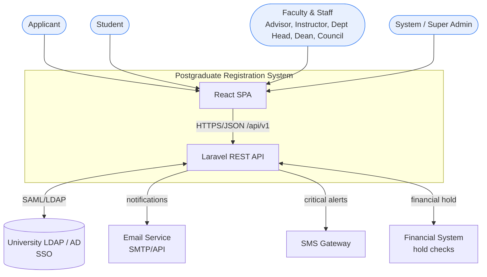
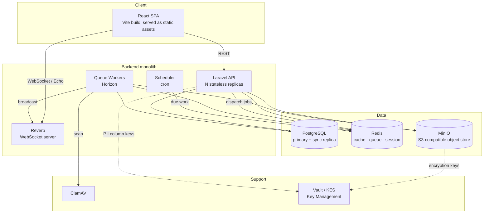
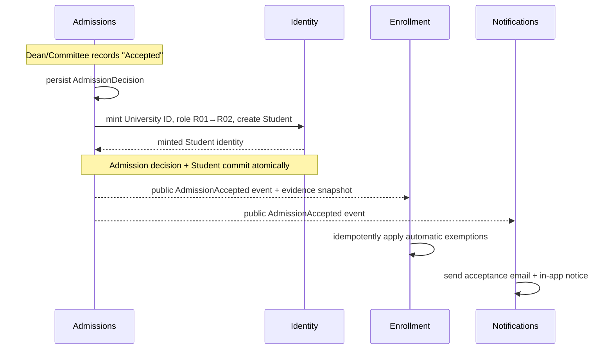
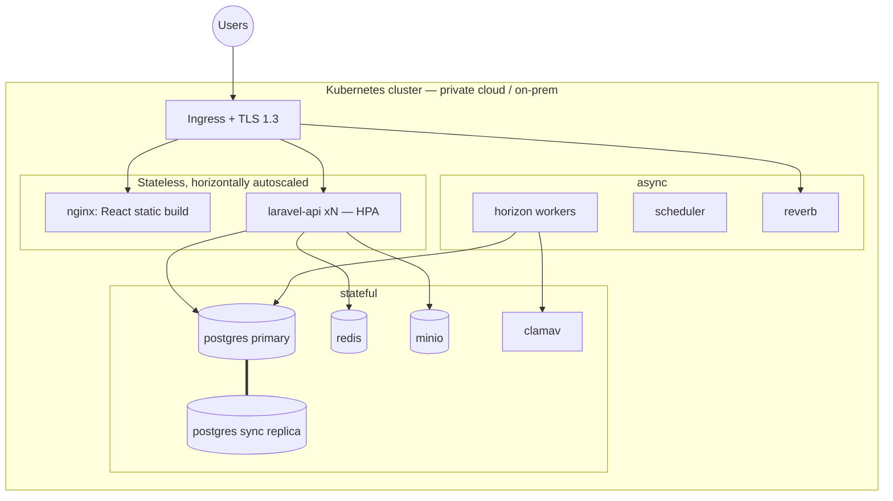

# Architecture — Postgraduate Registration System (PRS)

**Egypt-Japan University of Science and Technology (E-JUST)**
Faculties of Engineering (FoE), Basic & Applied Sciences (BAS), Computer Science & IT (CSIT)

| | |
|---|---|
| **Status** | Baseline architecture, v1.0 |
| **Source of truth** | [SRS.md](./SRS.md), [business-requirements.md](./business-requirements.md) |
| **Ubiquitous language** | [../CONTEXT.md](../CONTEXT.md) |
| **Key decisions** | [adr/0001](./adr/0001-decoupled-spa-rest-api.md) · [0002](./adr/0002-modular-monolith-seams.md) · [0003](./adr/0003-postgresql.md) · [0004](./adr/0004-self-hosted-on-prem-hosting.md) |

---

## 1. Architectural style

The PRS is built as **two decoupled modular monoliths**:

- a **React single-page application** (the frontend monolith), and
- a **headless Laravel REST API** (the backend monolith),

communicating over HTTPS/JSON through a versioned, OpenAPI-documented contract (`/api/v1`).

"Modular monolith" is applied to **both** tiers: each ships and deploys as one unit, but is internally divided into **bounded-context modules** with enforced seams. This gives us the operational simplicity of a monolith (one database, in-process calls, single transaction when needed, no distributed-systems tax) while keeping the option to extract a module into its own service later if scale demands it.

> **Why decoupled rather than an Inertia-style single app?** The SRS mandates a versioned REST API with OpenAPI 3.0 docs, OAuth2/JWT bearer auth, per-endpoint rate limiting, `Accept-Language` negotiation, and external/mobile clients. A headless API satisfies all of these directly; an Inertia monolith would force us to build and maintain a second API surface anyway. See [ADR-0001](./adr/0001-decoupled-spa-rest-api.md).

### Guiding principles

1. **Modules own their data.** No module reads or writes another module's tables. Cross-module access goes through published service facades or domain events only.
2. **Derive, don't duplicate.** Aggregate academic state (the Credit-Hour Summary, Academic Standing) is *computed* from the authoritative records, never stored as a separately-editable copy.
3. **The spec is the contract.** The OpenAPI document is generated from the backend and is the single source of truth for the frontend's typed API client.
4. **Data stays in-house.** Notifications, files, and search all run on university-controlled infrastructure to honour FERPA/data-protection posture (see [ADR-0004](./adr/0004-self-hosted-on-prem-hosting.md)).
5. **Configuration over code.** The many tunable rules (CH limits, SLAs, grade thresholds, retention) map to the configuration parameters in SRS Appendix C, not hard-coded constants.

---

## 2. System context (C4 Level 1)



External integrations (SRS §6.1): University LDAP/AD (SSO, inbound), Email service (outbound), SMS gateway (outbound), Financial system (bidirectional hold checks). Antivirus, document storage, and PDF generation are treated as **internal** services (see §6).

---

## 3. Container view (C4 Level 2)



| Container | Responsibility | Tech |
|-----------|----------------|------|
| React SPA | All UI; static build served by ingress/CDN | React + TypeScript + MUI |
| Laravel API | Stateless HTTP API, request auth, module orchestration | PHP 8.4 / Laravel 12 ([ADR-0006](./adr/0006-runtime-baseline-laravel-12-php-84.md)) |
| Queue Workers | Background jobs: email, malware scan, PDF, GPA recalc, SLA/reminder actions | Laravel Horizon |
| Scheduler | Time-driven work: SLA aging, Incomplete→FW conversion, reminders | Laravel scheduler |
| Reverb | Real-time push for the notification bell | Laravel Reverb (WebSockets) |
| PostgreSQL | System of record, primary + synchronous replica | PostgreSQL |
| Redis | Cache, queue backend, session store, rate limiting | Redis |
| MinIO | Encrypted document storage (S3 API) | MinIO |
| ClamAV | Upload malware scanning | ClamAV |
| Vault / KES | Dedicated KMS for at-rest encryption keys | HashiCorp Vault |

---

## 4. Backend module structure

The backend is divided into **domain modules** (which own data and business rules) and **supporting modules** (cross-cutting capabilities). Each module lives under `backend/modules/<Name>/` with a strict internal shape:

```
modules/Enrollment/
├── Public/                 ← the ONLY things other modules may import
│   ├── EnrollmentService.php       (facade / API of the module)
│   ├── Events/                     (domain events it publishes)
│   └── Dtos/                       (data crossing the boundary)
└── Internal/               ← private; invisible to other modules
    ├── Models/  Repositories/  Actions/  Policies/  Http/
```

`deptrac` enforces that `Internal/` of one module is never referenced from another module; only `Public/` may cross a boundary.

### 4.1 Domain modules

| Module | Owns (authoritative data) | Key responsibilities | SRS modules covered |
|--------|---------------------------|----------------------|---------------------|
| **Identity & Access** | users, roles, role-assignments, Student anchors and lifecycle status, sessions, MFA secrets, audit log | Login, SSO, MFA, RBAC (R01–R10), Student operational eligibility, session listing/termination, audit trail | Security & Auth |
| **Admissions** | applications, documents, screening notes, interviews, decisions | Multi-step application, email verification, document upload, SA→Dean→interview→decision workflow, status tracking | Admission |
| **Catalog** | faculties, departments, programs, courses, course-categories | Program/course CRUD + versioning, the interactive program tree, equivalencies | Program Management |
| **Enrollment** | enrollments, registration requests, standalone course-targeted exemptions, transfers, waivers, remediation obligations | Registration + advisor approval, add/drop/withdrawal, CH-limit and obligation-priority rules, exemption/transfer/waiver processing, remediation reconciliation ([ADR-0030](adr/0030-credit-decisions-are-not-enrollments.md), [ADR-0043](adr/0043-enrollment-owns-remediation-obligations.md)) | Course Registration, Exemption, Transfer & Waiver |
| **Grading** | grades, grade sheets | Instructor mark entry, letter-grade mapping, sign/finalize/review, Incomplete handling, **the GPA/CGPA read model** ([ADR-0020](adr/0020-grading-owns-gpa-read-model.md)) | Grading & GPA |
| **Academic Standing** | standing observations, termination cases | Derived Standing, Credit-Hour Summary, and advisory Graduation Readiness read models; transition notifications; termination criteria + workflow ([ADR-0029](adr/0029-academic-standing-owns-progress-read-models.md), [ADR-0041](adr/0041-standing-observations-not-snapshots.md)) | Academic Standing; Credit-Hour Summary |
| **Records** | transcript issuances | Transcript generation (official/unofficial), composition from academic-progress facades, PDF export | Transcript & Records |

### 4.2 Supporting modules

| Module | Responsibilities | SRS modules covered |
|--------|------------------|---------------------|
| **Notifications** | In-app (bell), email, SMS fan-out; per-user preferences | Notification & Alerts |
| **Calendar** | Academic calendar periods, interview slots, deadline definitions consumed by everyone | Calendar & Schedule |
| **Reporting** | Read-only cross-module reports and analytics (8 report types) | Reporting & Analytics |

### 4.3 The Credit-Hour Summary is derived, not stored

`Enrollment` owns *enrollments* (a Student taking a Course in a semester, each with a **Course Status**). `Grading` owns *grades* attached to those enrollments. `Enrollment` also owns *exemptions / transfers / waivers*. A Student's requirements come from the immutable admission-time Curriculum Version referenced by the Identity-owned Student anchor, resolved through `Catalog\Public` ([ADR-0034](adr/0034-students-bind-to-admission-curriculum-version.md)).

Catalog publishes an ID-only Public `CourseChanged` event after Course activation changes. Enrollment consumes it, re-reads authoritative Catalog data, and idempotently reconciles unused remediation opportunities; the existing global/per-Student recovery command handles missed post-commit delivery ([ADR-0043](adr/0043-enrollment-owns-remediation-obligations.md)).

The **Credit-Hour Summary** and **Academic Standing** are **read models** computed on demand from those authoritative records using the counting rules in SRS Appendix D. The `AcademicStanding` module owns both calculations and exposes them through its public facade; `Records` later consumes that facade when composing a Transcript ([ADR-0029](adr/0029-academic-standing-owns-progress-read-models.md)). This keeps a single source of truth and avoids the classic bug of a stored balance drifting from the transactions that produced it. For a determinate remediation checkpoint, AcademicStanding atomically invokes Enrollment's idempotent Public evaluation command with the obligation id and expected deadline; Enrollment remains the only obligation writer and stale Calendar data cannot commit Case effects ([ADR-0043](adr/0043-enrollment-owns-remediation-obligations.md)).

> **Amended by [ADR-0020](adr/0020-grading-owns-gpa-read-model.md) (Phase 4).** The **GPA/CGPA** read model is owned by **`Grading`**, not `Records` — a GPA is grade arithmetic and belongs beside the Grades it is arithmetic over, and `Records` is a document-issuance context that is not born until Phase 6. `Records` composes a transcript *from* `Grading\Public`; it does not recompute the average. The Redis caching described above also remains a documented later optimization rather than the built design: this build has no Redis ([ADR-0005](adr/0005-localhost-learning-build.md)), so the values are computed on demand and cannot drift at all. §9's module map below carries the same amendment.

---

## 5. Module communication

Two mechanisms, deliberately limited:

1. **Synchronous — public service facades.** When module A needs data or an action from module B *right now* and within the same request, it calls `B\Public\BService`. Example: `Enrollment` asks `Catalog` "is this course an internal elective for the student's program?"

2. **Asynchronous — in-process domain events.** When something happens that other modules should *react* to, the owning module publishes an event; interested modules subscribe. Reactions run in the same process (queued when slow). This keeps modules decoupled — the publisher doesn't know who listens.



Representative events: `ApplicationSubmitted`, `EmailVerified`, `AdmissionAccepted`, `RegistrationRequested`, `RegistrationApproved`, `WithdrawalRecorded`, `GradeFinalized`, `IncompleteExpired`, `StandingChanged`, `TerminationRecommended`, `TranscriptIssued`. Every one of these is also an audit-log entry and a potential notification trigger.

`AdmissionAccepted` is an Admissions Public event whose immutable evidence snapshot lets
Enrollment apply automatic Exemptions without reading Admissions data. It fires after the
admission/Student transaction commits; an idempotent reconciliation command is the recovery
path for listener failure ([ADR-0032](adr/0032-public-admission-evidence-event.md)).

---

## 6. Cross-cutting concerns

**Authentication & RBAC** — Sanctum SPA cookie session for the first-party app (HttpOnly/Secure/SameSite + CSRF, per SRS FR-SEC-003); Socialite (OAuth) + SAML2/LDAP bridge for university SSO; TOTP MFA enforced for all roles above Student. RBAC is enforced twice: route/policy middleware on the API, and route-guard + conditional rendering on the SPA. Authorization is never trusted from the client. See [ADR-0001].

**Internationalisation (Arabic RTL / English LTR)** — backend returns localized strings via Laravel localization keyed off `Accept-Language`; frontend uses `react-i18next`, and MUI's theme direction flips the entire layout to RTL for Arabic. Language switches at runtime without reload (NFR-USB-005).

**Notifications** — the Notifications module is the single fan-out point. In-app messages are pushed live via Reverb→Echo; email and SMS go through queued jobs to the external gateways. All three channels are driven by the same domain events.

**Document handling** — uploads go directly to MinIO via presigned URLs; a queued job runs the ClamAV scan and marks the document clean/quarantined before it is usable. Objects are encrypted at rest (SSE) with keys held in Vault/KES. PII columns in Postgres are encrypted with keys from the same KMS.

**PDF generation** — transcripts render through Browsershot (headless Chromium) so Arabic RTL text, the university seal/watermark, digital signature, and verification QR code all render faithfully; DomPDF was rejected for poor Arabic support.

**Audit & observability** — every CRUD on sensitive data and every auth event is written to an append-only audit log retained ≥ 7 years (NFR-SEC-005). Metrics via Prometheus/Grafana, error tracking via Sentry, centralized application logs.

**Search** — the program tree and general search use PostgreSQL full-text search via Laravel Scout, meeting the ≤ 1s NFR without a separate search service; Meilisearch is the documented escape hatch if the corpus outgrows Postgres FTS.

---

## 7. Frontend architecture

The SPA mirrors the backend's bounded contexts as **feature modules**, with `eslint-plugin-boundaries` forbidding cross-feature imports — the frontend analogue of the backend facades.

```
frontend/src/
├── app/                    # bootstrap, router, providers, theme (light/dark, RTL/LTR)
├── features/
│   ├── admissions/         # each feature: components, hooks, routes, api, model
│   ├── catalog/
│   ├── enrollment/
│   ├── grading/
│   ├── standing/
│   ├── records/
│   ├── notifications/
│   └── auth/
└── shared/                 # design system wrappers, layout, i18n, utils (cross-cutting ONLY)
```

- **Server state** via TanStack Query against a **typed API client generated from the OpenAPI spec** — the frontend never hand-writes request/response types.
- **Local/UI state** via Zustand; **forms + validation** via React Hook Form + Zod (Zod schemas mirror the backend validation rules).
- **Routing** via React Router with role-aware guards; each role (R01–R10) sees a tailored dashboard composed from feature modules.
- **Responsive** desktop/tablet/mobile and **WCAG 2.1 AA** are baseline acceptance criteria, not afterthoughts.

---

## 8. Deployment view



**How the NFRs are met:**

| NFR | Mechanism |
|-----|-----------|
| 99.9% uptime, 60s failover | Multiple API replicas behind ingress; Postgres primary + synchronous replica with automated promotion |
| 5,000 concurrent users | Stateless API + horizontal pod autoscaling; Redis-backed sessions so any replica serves any request |
| RPO ≤ 15 min, RTO ≤ 1h | Synchronous replication + full-daily / incremental-4h encrypted backups |
| Page ≤ 2s / API ≤ 500ms (p95) | CDN-served static SPA, Redis caching of derived read models, indexed Postgres queries |
| Planned maintenance window | Rolling deploys; Sat 02:00–06:00 window reserved |

---

## 9. SRS module → code module map

| SRS §2.1 module | Code module(s) |
|-----------------|----------------|
| Security & Auth | Identity & Access |
| Admission | Admissions |
| Program Management | Catalog |
| Course Registration | Enrollment |
| Exemption | Enrollment |
| Transfer & Waiver | Enrollment |
| Grading & GPA | Grading (incl. the GPA/CGPA read model — [ADR-0020](adr/0020-grading-owns-gpa-read-model.md), amending the original "+ Records") |
| Academic Standing | Academic Standing |
| Transcript & Records | Records + Academic Standing for the Credit-Hour Summary read model ([ADR-0029](adr/0029-academic-standing-owns-progress-read-models.md)) |
| Notification & Alerts | Notifications |
| Calendar & Schedule | Calendar |
| Reporting & Analytics | Reporting |

---

## 10. Key end-to-end flows

**Course registration (SRS §4.4.3):** SPA (Enrollment feature) → `POST /api/v1/registrations` → `EnrollmentService` validates CH limits (min 6 / max 12, config-driven), category rules, and prerequisites via `Catalog` facade → persists a *RegistrationRequest* (status Pending) → publishes `RegistrationRequested` → Notifications alerts the Advisor. Advisor approves → `RegistrationApproved` → enrollments created, `Calendar` add/drop window checked → SPA reflects Approved.

**Grade → standing (SRS §4.7, §4.8):** Instructor enters marks → `Grading` maps to letter grade → signs → Dept Head reviews → `GradeFinalized` published → `AcademicStanding` recomputes the Student's Standing and Credit-Hour Summary on demand → if termination criteria are met, a Termination case starts the council workflow. Final termination and replacement Exemption approval serialize through an Identity Public transaction-scoped Student guard acquired before module-owned locks; each revalidates after locking, so commit order resolves the race without stale dual outcomes. Final termination also calls Enrollment's idempotent Public closeout command in the same transaction, rejecting all non-terminal registration and credit-decision requests while preserving history and existing Enrollments/effective decisions ([ADR-0040](adr/0040-termination-pushes-student-lifecycle-status.md)).

**Incomplete lifecycle (SRS §4.7.3):** on `I` grade, scheduler tracks the resolution deadline (10th week of next semester); reminder jobs fire at 4wk/2wk/1wk/1day; if unresolved, scheduler emits `IncompleteExpired` → `Grading` converts to `FW` → standing recomputes.

---

*Companion documents: [tech-stack.md](./tech-stack.md) for the concrete technology choices; [../CONTEXT.md](../CONTEXT.md) for domain vocabulary; [adr/](./adr/) for the reasoning behind the hard-to-reverse decisions.*
